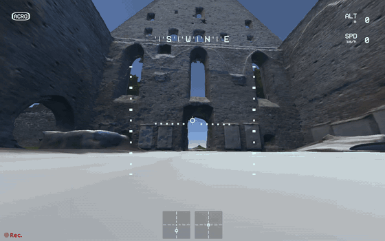

# liftoff_maps

Fly your own 3D scans in [Liftoff: FPV Drone Racing](https://store.steampowered.com/app/410340/).
Turn a textured photogrammetry model (a RealityScan, Metashape or Polycam
export) into a map, and this [BepInEx](https://github.com/BepInEx/BepInEx) mod
places it in Liftoff's empty grid level, **The Drawing Board**. You spawn in the
middle of your scan, with collisions that behave like the game's own ground.

<p align="center">
  
  <br><sub>A scan of the Pirita convent ruins (Tallinn), flown in Liftoff</sub>
</p>

> [!IMPORTANT]
> **Unofficial. No affiliation, no warranty.** This project is not made,
> endorsed or supported by LuGus Studios, the makers of Liftoff, and has no
> connection to them. Liftoff is their trademark. You use it entirely at your
> own risk: the authors take no responsibility for anything it does to your
> game, your save data, your Steam or Liftoff account, or anything else.
>
> **The game notices the mod.** Liftoff shows an "External game modifications"
> notice at startup and pauses competitive features (such as leaderboards)
> while mods are active. It may also report the mod to LuGus Studios, for
> example in crash reports. Use it for single-player free flight only. Don't
> join multiplayer with it installed, and don't ask LuGus Studios for support
> with a modded game.

**Tested with:** Liftoff 1.7.6 (Unity 2022.3.62f3), native Linux build, Steam,
BepInEx 5.4.23.5. The Windows build should work the same way but is untested.

- [What you need](#what-you-need)
- [Your scan: input format](#your-scan-input-format)
- [Install](#install)
- [Using it](#using-it)
- [Uninstall](#uninstall)
- [Troubleshooting](#troubleshooting)
- [For AI assistants](#for-ai-assistants)
- [How it works](#how-it-works)

## What you need

- **Liftoff** on Steam. These steps are written for the native Linux version.
- **A scan:** a textured OBJ (see below).
- **Python 3.10+**, to convert the scan (`pip install -r tools/requirements.txt`
  installs numpy, meshoptimizer and Pillow).
- **.NET 8 SDK**, to build the plugin. No IDE is needed; `dotnet` on the command
  line is enough.
- **curl**, to download BepInEx (`scripts/package.sh` does it).

The mod builds against your own copy of the game's assemblies. No game files
are part of this repository, and none should ever be committed to it.

## Your scan: input format

The converter (`tools/convert_scan.py`) takes a **Wavefront OBJ** with:

| Requirement | Details |
| --- | --- |
| Triangles with texture coordinates | Faces as `f v/vt v/vt v/vt`, or `f v/vt/vn …` (normals are ignored). Triangulate on export. |
| Exactly one material with one texture | The `.mtl` next to the OBJ names it with `map_Kd`; PNG or JPEG. Multi-texture exports (`*_u1_v1`, `*_u2_v1`, …) aren't supported: export to a single texture (RealityScan: *Export to one texture*). Use `--texture` if the `.mtl` is missing. |
| Units in metres | Real-world scale. |
| Z up (default) or Y up | RealityScan and Metashape export Z up. Blender's default OBJ export and Polycam use Y up: pass `--up y`. |
| Local coordinates | Not geographic coordinates (no huge offsets such as UTM). RealityScan's default *local* export is right. |
| Sensible size | Tested with a 100 × 64 × 45 m scan of 10 M triangles (a 1.1 GB OBJ) and an 8192 px texture. The Drawing Board is 4 × 4 km. Scans taller than about 50 m are untested. |

Vertex colours and normals are ignored; the converter computes normals itself.

**Where you spawn:** the drone starts in the horizontal middle of the scan, on
the topmost surface there (a floor, a roof or a treetop). Every reset puts you
back there.

## Install

The paths below assume the default Steam library on Linux:

```bash
GAME=~/.local/share/Steam/steamapps/common/Liftoff
```

If Liftoff is installed elsewhere, find it under the `path` entries in
`~/.local/share/Steam/steamapps/libraryfolders.vdf`, or in Steam via
Liftoff → Manage → Browse local files.

**1. Get the code and the game's assemblies** (needed for building only):

```bash
git clone https://github.com/hronecviktor/liftoff_maps.git
cd liftoff_maps
mkdir -p game && cp -r "$GAME/Liftoff_Data/Managed" game/
```

**2. Convert your scan** (takes about 30 s for 10 M triangles):

```bash
pip install -r tools/requirements.txt
python3 tools/convert_scan.py /path/to/scan.obj dist/maps/myscan
```

This writes `dist/maps/myscan/myscan.lmap` and `myscan.jpg`.

| Option | Default | Meaning |
| --- | --- | --- |
| `--up z\|y` | `z` | The scan's up axis |
| `--name` | OBJ file name | Map name |
| `--texture` | from the `.mtl` | Texture image |
| `--render-ratio` | `0.12` | Fraction of triangles kept for drawing. Lower it if the frame rate suffers. |
| `--collision-ratio` | `0.02` | Fraction kept for collisions |
| `--texture-size` | `8192` | Maximum texture side; `4096` saves video memory |
| `--chunk` | `25` | Chunk size in metres |

**3. Build the mod and assemble the files to install:**

```bash
scripts/package.sh
```

This downloads BepInEx 5 for Linux, builds the plugin and lays everything out
in `dist/overlay/`, mirroring the game folder, including your maps from
`dist/maps/`.

**4. Copy into the game** with Liftoff closed. This only adds files and never
overwrites any of the game's own:

```bash
cp -r dist/overlay/. "$GAME/"
```

**5. Set the Steam launch option.** In Steam, open Liftoff → Properties →
General → Launch options, and enter:

```
./run_bepinex.sh %command%
```

### Windows (untested)

Use BepInEx 5 for Windows x64 instead of the Linux build: unzip it into the game
folder. Then copy `mod/LiftoffImport/bin/Release/net472/LiftoffImport.dll` and
your `dist/maps/` folder to `BepInEx/plugins/LiftoffImport/`, and
`mod/overlay/BepInEx/config/BepInEx.cfg` to `BepInEx/config/`. No launch option
is needed. For the Windows build under Proton, use the launch option
`WINEDLLOVERRIDES="winhttp=n,b" %command%`.

## Using it

1. Start Liftoff. Confirm the "External game modifications" notice.
2. Choose Free Flight in **The Drawing Board**. Loading takes a few seconds
   longer than usual the first time.
3. You start on your scan. The grid floor continues just below the scan's
   lowest edges.

| Key | Action |
| --- | --- |
| <kbd>F9</kbd> | Switch between lit shading (default) and emissive shading, which shows the texture exactly as captured |
| <kbd>F8</kbd> | Write a dump of the loaded level to `BepInEx/LiftoffImport/`, for debugging |

Settings live in `BepInEx/config/is.0s.liftoff-import.cfg` (created on first
start):

| Setting | Default | Meaning |
| --- | --- | --- |
| `[Map] File` | empty | Map to load, relative to `BepInEx/plugins/LiftoffImport/` (for example `maps/myscan/myscan.lmap`). Empty: the first `.lmap` under `maps/`. |
| `[Map] Emissive` | `false` | Start with emissive shading |
| `[Map] ShadingKey`, `[Probe] DumpKey` | `F9`, `F8` | Keys |

**To add another map,** convert it into `dist/maps/<name>/`, run
`scripts/package.sh` and copy the files again, or copy the two files into
`BepInEx/plugins/LiftoffImport/maps/<name>/` directly. Then point `[Map] File`
at the map you want to fly.

## Uninstall

1. Clear the launch option. That alone turns the mod off.
2. Delete `run_bepinex.sh`, `libdoorstop.so`, `.doorstop_version`,
   `changelog.txt` and the `BepInEx/` folder from the game folder.

## Troubleshooting

Two logs help with almost everything:

- `$GAME/BepInEx/LogOutput.log` is the mod's log. Look for the lines starting with
  `[Info   :Liftoff Import]`, such as `loaded map …` and `installed … start point at …`.
- `~/.config/unity3d/*/Liftoff/Player.log` is the game's own log.

| Symptom | Likely cause |
| --- | --- |
| The Drawing Board looks normal | No map was found: the log says `no .lmap file under …` or `configured map … not found`. |
| You see the scan from below, or start under it | The scan is upside down: convert again with the other `--up` value. |
| The scan is mirrored | Your exporter uses a left-handed axis convention. Please open an issue. |
| The menu never finishes loading | Check `LogOutput.log` for errors and open an issue with both logs. |
| Low frame rate | Convert with a lower `--render-ratio` (for example `0.05`) or `--texture-size 4096`. |
| You crash into air, or fly through walls | Raise `--collision-ratio` (for example `0.05`). |

## For AI assistants

This section is for an AI coding assistant (for example Claude Code) helping a
user install their own map. Follow the [Install](#install) steps. In addition:

1. **Ask the user for:**
   - the path to their scan (OBJ, `.mtl` and texture);
   - which program exported it (this decides `--up`; if unsure, ask or inspect
     the bounding box: the up axis is usually the smallest one, and the ground
     sits at its low end);
   - whether Liftoff runs as the native Linux build, on Windows, or under Proton.
2. **Check the input before converting:**
   - `grep -c '^usemtl' scan.obj` should be 1 (or several lines all naming the same material);
   - the `.mtl` has a `map_Kd` line;
   - face lines look like `f 1/1 2/2 3/3` or `f 1/1/1 2/2/2 3/3/3`, triangles
     with UVs. Quads or faces without UVs (`f v//vn`) need re-exporting.
   The converter stops with a clear message on unsupported input.
3. **Find the game folder** rather than guessing: check
   `libraryfolders.vdf` (see above), then confirm `Liftoff_Data/Managed/Assembly-CSharp.dll` exists.
4. **Build and package:** `scripts/package.sh` needs `dotnet` (8.0) on `PATH`.
   If it's missing, install the SDK in the user's home folder with
   [dotnet-install](https://learn.microsoft.com/dotnet/core/tools/dotnet-install-script)
   (`--channel 8.0`) instead of system-wide, after asking.
5. **Installing into the game folder and setting the launch option are the
   user's decisions.** Explain the disclaimer above before doing either, and
   let the user set the Steam launch option themselves.
6. **After the first launch,** read `BepInEx/LogOutput.log` and confirm
   `installed '<map>' in The Drawing Board`, with a start point near height 0.
   If the user reports problems, compare against [Troubleshooting](#troubleshooting).
7. **Don't:**
   - commit anything from `game/`, `decompiled/` or `data/`, or the user's scans;
   - redistribute game files or decompiled game code;
   - try to hide the mod from the game's mod detection, or disable its crash
     reporting.

## How it works

**`tools/convert_scan.py`** reads the OBJ in blocks (a 1 GB file needs a few
hundred MB of memory) and converts it to Unity's left-handed, Y-up axes,
reversing the triangle winding to match. It centres the scan horizontally and
sets height 0 to the top surface in the middle. It then splits the scan into
25 m chunks and decimates each one with
[meshoptimizer](https://github.com/zeux/meshoptimizer), keeping chunk borders
locked so neighbouring chunks still meet. Each chunk gets a render mesh and a
coarser collision mesh. Everything is written to a single `.lmap` file,
alongside the texture as a JPEG.

`.lmap` layout, little endian:
1. `"LMAP"`, a `u32` version (1) and a `u32` header length;
2. a JSON header with the name, texture, floor height, bounds and, per chunk,
   vertex and triangle counts plus array offsets;
3. zero padding to 4 bytes;
4. the arrays: float32 positions (xyz), float32 UVs (uv) and uint32 indices.

**The plugin** (`mod/LiftoffImport`) is a BepInEx 5 plugin. When The Drawing
Board loads, during the level's `sceneLoaded` and before the drone spawns, it:

1. adds the scan's chunks as mesh renderers (Standard shader, texture as albedo);
2. adds mesh colliders marked as the game's ground (`GroundObject`,
   `DroneObjectCollider` with the floor's crash material);
3. moves the grid floor and its collider just below the scan's lowest edges;
4. hides the coordinate labels;
5. raises the drone's start point to 15 cm above the scan's surface, found by
   raycast.

Liftoff destroys BepInEx's manager object during startup, so the plugin runs
from its own hidden object. It also never lets an exception escape: the game
would upload it as a crash report, and an exception in `sceneLoaded` would stop
the game's own handlers from running.

**Repository layout:**

| Path | Contents |
| --- | --- |
| `tools/` | Scan converter and its Python requirements |
| `mod/LiftoffImport/` | The plugin (C#, .NET Framework 4.7.2) |
| `mod/overlay/` | Files installed as-is (BepInEx config) |
| `scripts/package.sh` | Downloads BepInEx, builds the plugin, assembles `dist/overlay/` |
| `game/`, `data/`, `dist/` | Your game assemblies, your scans, build output. Ignored by git. |
